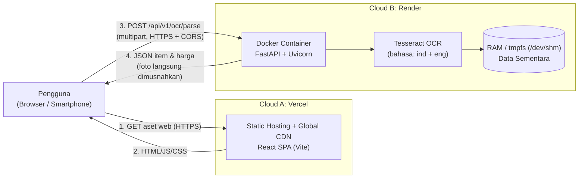

# Smart Split Bill 🧾
### Aplikasi Pemecah Tagihan Berbasis OCR dengan Arsitektur Decoupled Multi-Cloud (Multi-Provider)

Aplikasi web pemecah tagihan (*split bill*) yang memungkinkan pengguna memotret struk restoran atau belanjaan, mengekstrak item dan harga secara otomatis menggunakan **Tesseract OCR (bahasa Indonesia & Inggris)**, dan membagi tagihan secara proporsional dan adil (**selisih Rp 0** menggunakan metode *Largest Remainder*).

---

## 🏗️ Arsitektur Sistem

Sistem ini menerapkan **Decoupled Multi-Provider Architecture**:
1. **Frontend (Vercel)**: Single Page Application (SPA) berbasis **React 19, TypeScript, dan Tailwind CSS**, disajikan melalui Global CDN Vercel.
2. **Backend (Render)**: REST API berbasis **FastAPI & Tesseract OCR 5.x** yang dibungkus dalam kontainer **Docker** (`python:3.11-slim`).



---

## 🔒 Privasi: Ephemeral by Design (Zero Data Retention)

- **Tidak Ada Database / Cloud Storage**: Backend tidak terhubung ke database maupun cloud bucket (S3/GCS).
- **Proses Murni di RAM**: Foto dibaca langsung dari byte stream di memori/`tmpfs` (`/dev/shm`).
- **Pembersihan Eksplisit**: Referensi data dihapus di blok `finally` dan `gc.collect()` dipanggil seketika setelah respons terkirim.
- **Log Bebas Konten Pribadi**: Log backend hanya mencatat metadata teknis (status code, durasi, ukuran berkas). Tidak pernah mencatat teks OCR atau foto struk.
- **Client-Side State**: Seluruh daftar peserta dan pembagian hanya tersimpan di memori browser pengguna dan hilang otomatis saat tab ditutup.

---

## 🚀 Fitur Utama

- 📸 **Unggah Foto Struk**: Dari kamera langsung atau galeri (mendukung JPG, PNG, WebP, dan format iPhone HEIC/HEIF).
- 🔄 **Normalisasi EXIF & Kompresi Klien**: Gambar dinormalisasi agar tidak terbalik dan dikompresi (< 1 MB) di browser sebelum dikirim untuk menghemat bandwidth.
- ⚡ **Ekstraksi OCR Cerdas**: Mengenali nama menu, kuantitas, harga, subtotal, pajak (PB1/PPN), service charge, dan diskon.
- ✏️ **Review & Koreksi Manual**: Pengguna dapat mengubah nama, kuantitas, harga, atau menambah item baru secara manual.
- 👥 **Kelola Peserta & Penugasan**: Tambah teman tanpa akun. Dukungan untuk menu pribadi maupun patungan bersama.
- ⚖️ **Kalkulasi Proporsional (Largest Remainder)**: Pajak dan diskon dibagi proporsional sesuai porsi belanja masing-masing. Sisa pembulatan Rupiah dialokasikan dengan metode *Largest Remainder* sehingga **total peserta sama persis dengan total struk (selisih Rp 0)**.
- 📋 **Ekspor Praktis**: Salin format teks siap kirim ke WhatsApp/Telegram, atau unduh gambar ringkasan (dibuat via HTML5 Canvas tanpa upload ke server).
- ☕ **Indikator Cold-Start**: Menampilkan status kesiapan server Render dan warm-up ping otomatis.

---

## 🛠️ Tech Stack

| Komponen | Teknologi |
|---|---|
| **Frontend Framework** | React 19 + TypeScript + Vite |
| **Styling** | Tailwind CSS v4 |
| **State Management** | Zustand (Client-side) |
| **Client Image Prep** | `browser-image-compression`, `heic2any` |
| **Frontend Hosting** | Vercel (Global Edge CDN) |
| **Backend Framework** | Python 3.11 + FastAPI + Uvicorn |
| **OCR Engine** | Tesseract OCR 5.x (`ind` & `eng`) via `pytesseract` |
| **Image Preprocessing** | OpenCV (`opencv-python-headless`), Pillow, NumPy |
| **Rate Limiter** | `slowapi` (berbasis `X-Forwarded-For`) |
| **Containerization** | Docker (`python:3.11-slim`, non-root user) |
| **Backend Hosting** | Render (Web Service Docker) |
| **CI/CD** | GitHub Actions |

---

## 💻 Panduan Menjalankan Secara Lokal

### 1. Prasyarat
- Node.js v18+ dan npm
- Python 3.11+

### 2. Menjalankan Backend (`smart-split-bill-be`)
```powershell
cd smart-split-bill-be

# Buat dan aktifkan virtual environment (jika belum)
python -m venv venv
.\venv\Scripts\activate

# Install dependensi
pip install -r requirements.txt

# Jalankan server FastAPI
uvicorn app.main:app --reload --port 8000
```
API Documentation (Swagger UI) dapat dibuka di: `http://localhost:8000/docs`

### 3. Menjalankan Frontend (`smart-split-bill-fe`)
```powershell
cd smart-split-bill-fe

# Install dependensi
npm install

# Jalankan development server
npm run dev
```
Buka browser di `http://localhost:5173`.

---

## 🌐 Variabel Lingkungan (Environment Variables)

### Frontend (Vercel)
| Variabel | Keterangan | Contoh |
|---|---|---|
| `VITE_API_BASE_URL` | URL publik backend Render | `https://smart-split-bill-api.onrender.com` |

### Backend (Render)
| Variabel | Keterangan | Contoh |
|---|---|---|
| `ALLOWED_ORIGINS` | Allowlist origin CORS | `https://smart-split-bill.vercel.app` |
| `MAX_UPLOAD_MB` | Batas ukuran upload foto | `5` |
| `RATE_LIMIT` | Batas rate limit request per menit | `15/minute` |

---

## 🧪 Pengujian (Testing)

Jalankan pengujian unit test backend:
```powershell
cd smart-split-bill-be
python -m tests.test_parser
python -m tests.test_api
```

Jalankan type-check dan build frontend:
```powershell
cd smart-split-bill-fe
npm run build
```

